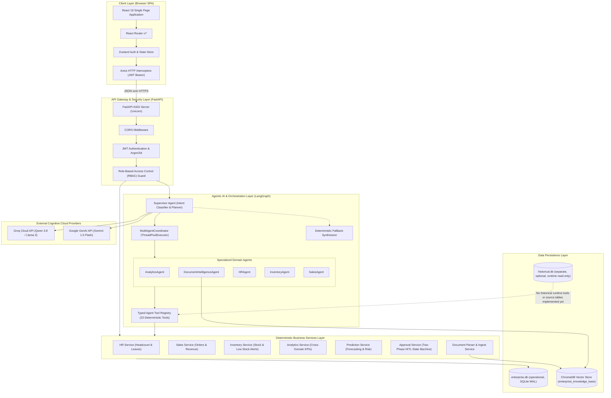
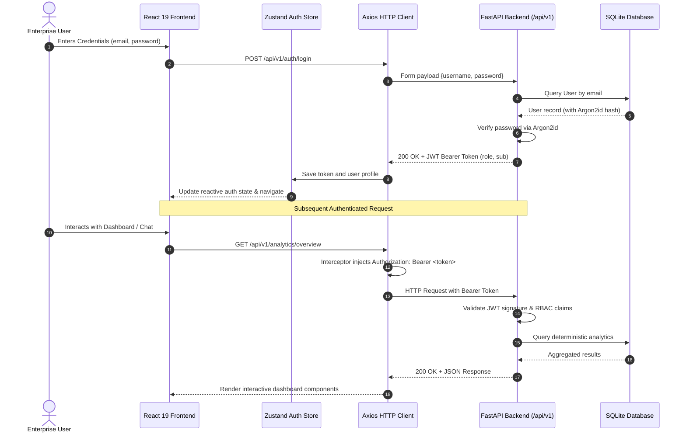
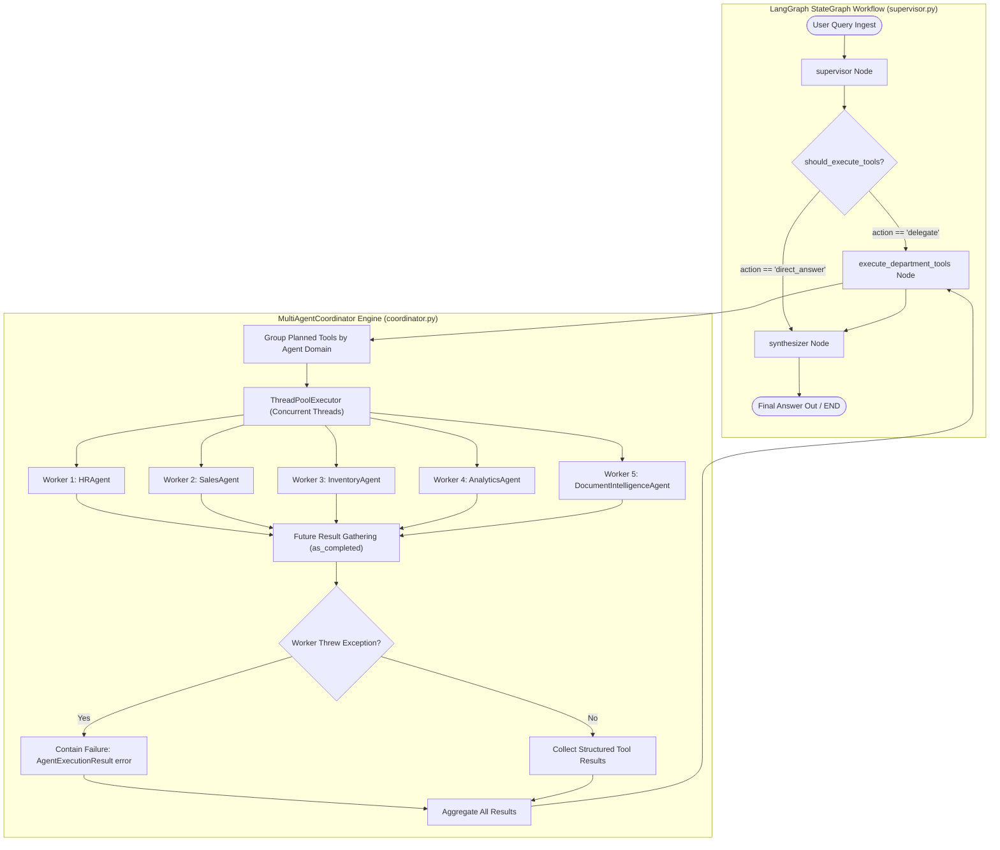
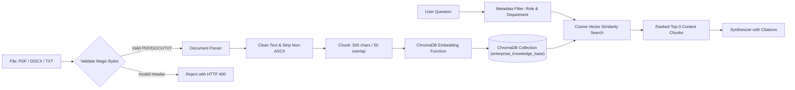
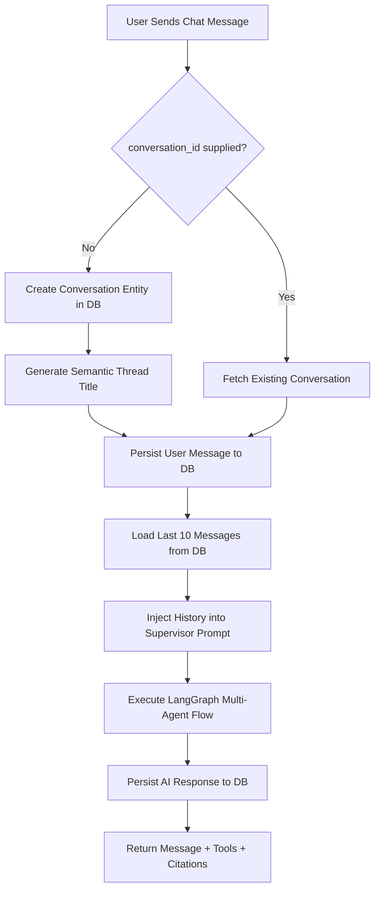
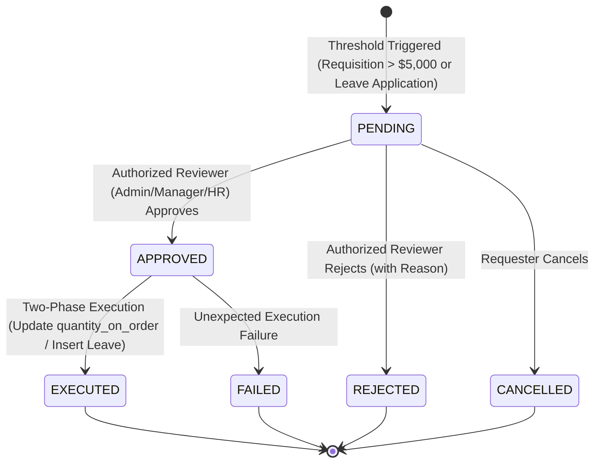
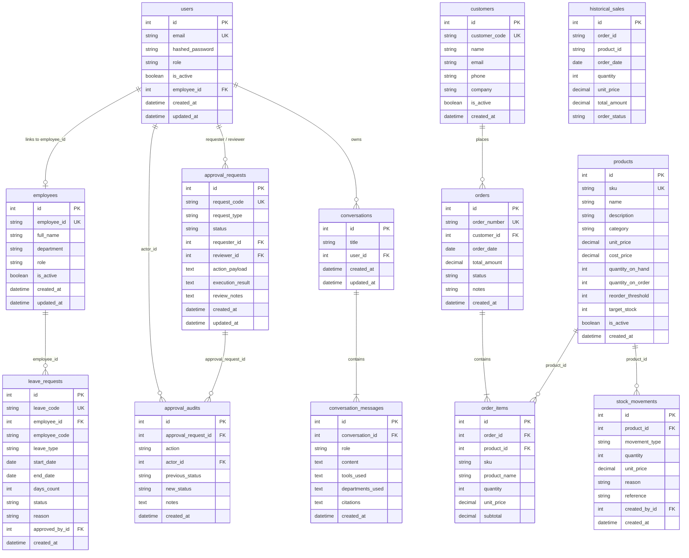

# Comprehensive System Architecture & Engineering Specification

**Project:** Agentic AI Based Intelligent Enterprise Automation and Decision Support System
**Repository:** [https://github.com/Devashree-b-s/agentic-ai-enterprise-automation](https://github.com/Devashree-b-s/agentic-ai-enterprise-automation)
**Document Path:** `docs/ARCHITECTURE.md`
**Version:** 2.0 (Production Verified)
**Date:** November 2026

---

## 1. High-Level Architectural Paradigm

The **Agentic AI Integrated Enterprise and Decision Support System** is designed around a hybrid architectural principle: **Cognitive Agentic Orchestration coupled with Strict Deterministic Execution**.



### Architectural Guarantees:
1. **Mathematical Determinism:** Large Language Models (LLMs) are restricted strictly to language comprehension, query decomposition, and final text formatting. They are never permitted to generate SQL on the fly, estimate revenues, calculate leave balances, or decrement inventory. All calculations are executed by deterministic Python services and SQL aggregate functions.
2. **Access Isolation:** Authorization is enforced at the API gateway layer and re-verified inside individual tools before any database query executes.
3. **Execution Safety (Human-in-the-Loop):** Sensitive mutations (such as purchase requisitions > $5,000 or employee leave requests) are intercepted, generating an approval ticket rather than immediately executing state changes.

---

## 2. Frontend and Backend Communication

Communication between the React single-page application and the FastAPI backend follows modern REST standards with asynchronous JSON interchange and centralized JWT session handling.



### Protocol & Security Features:
- **Authorization Header:** Every protected request sends `Authorization: Bearer <jwt_access_token>`.
- **Axios Response Interceptors:** Intercepts HTTP 401 Unauthorized errors and automatically cleanses local auth state, redirecting unauthenticated users to `/login`.
- **CORS Configuration:** Strictly binds origins via `CORSMiddleware`, restricting access to designated frontend origins.

---

## 3. FastAPI Application Structure

The backend application is organized into modular packages separating routing, business logic, schemas, security primitives, and database models.

```text
backend/app/
├── api/                       # HTTP Route Controllers (FastAPI APIRouters)
│   ├── agents.py              # /api/v1/agents/chat (LangGraph supervisor endpoint)
│   ├── analytics.py           # /api/v1/analytics/* (Executive KPIs, cross-domain metrics)
│   ├── approvals.py           # /api/v1/approvals/* (Two-phase HITL state machine)
│   ├── auth.py                # /api/v1/auth/* (Login, register, user management)
│   ├── conversations.py       # /api/v1/conversations/* (Chat thread persistence)
│   ├── documents.py           # /api/v1/documents/* (RAG ingestion, search, Q&A)
│   ├── hr.py                  # /api/v1/hr/* (Employee CRUD, leave tracking)
│   ├── inventory.py           # /api/v1/inventory/* (Products, stock movements, low-stock)
│   ├── predictions.py         # /api/v1/predictions/* (Forecasting & SKU risk models)
│   └── sales.py               # /api/v1/sales/* (Customers, orders, revenue reports)
│
├── agents/                    # Multi-Agent Framework (LangGraph Orchestration)
│   ├── coordinator.py         # MultiAgentCoordinator & ThreadPoolExecutor
│   ├── llm.py                 # LLM provider factory (Groq & Gemini + Fallback)
│   ├── prompts.py             # System prompts, guardrails, role boundaries
│   ├── state.py               # Typed AgentState & SupervisorDecision schemas
│   ├── supervisor.py          # StateGraph workflow, routing, and synthesis nodes
│   ├── specialized/           # Specialized Department Agents
│   │   ├── base.py            # BaseSpecializedAgent abstract class
│   │   ├── analytics_agent.py # AnalyticsAgent (KPIs, forecasting)
│   │   ├── document_agent.py  # DocumentIntelligenceAgent (ChromaDB RAG)
│   │   ├── hr_agent.py        # HRAgent (Headcount, leaves, staffing)
│   │   ├── inventory_agent.py # InventoryAgent (Stock levels, low-stock alerts)
│   │   └── sales_agent.py     # SalesAgent (Revenue, order trends)
│   └── tools/                 # 23 registered deterministic tool implementations
│
├── services/                  # Deterministic Business Services Layer
│   ├── analytics_service.py   # Cross-department correlation calculations
│   ├── approval_service.py    # HITL approval lifecycle & idempotency logic
│   ├── chroma_service.py      # ChromaDB collections, embeddings, metadata filtering
│   ├── conversation_service.py# Chat thread and message history persistence
│   ├── document_parser.py     # Binary header verification, PDF/DOCX/TXT extraction
│   ├── hr_service.py          # Employee and leave allocation calculations
│   ├── inventory_service.py   # Stock movements, low-stock math, replenishment
│   ├── prediction_service.py  # Time-series model evaluation (MAE/RMSE/MAPE)
│   ├── rag_synthesizer.py     # Document citation and snippet synthesis
│   └── sales_service.py       # Order confirmation deduction, revenue aggregation
│
├── ingestion/                 # Explicit-target CSV/XLSX validation, staging, and loading
├── models/                    # SQLAlchemy 2.0 Relational Models
├── schemas/                   # Pydantic v2 Validation Schemas
├── core/                      # Configuration, Security & Migrations
└── db/                        # Engine, SessionLocal, Base Model
```

---

## 4. LangGraph Supervisor Workflow & Multi-Agent Coordination

Natural language understanding and task coordination are implemented through a **Stateful Directed Cyclic Graph** using **LangGraph**.



### 4.1 State Schema (`AgentState`)
The state flowing through the graph contains:
- `query`: The sanitized user query string.
- `user_role` & `user_id`: Authenticated identity context.
- `history`: Last 10 turns of conversational context.
- `target_departments`: Classified operational domains (e.g. `['sales', 'inventory']`).
- `planned_tools`: Structured list of `PlannedTool(tool_name, arguments, reason)`.
- `tool_results`: Consolidated list of tool outputs returned by agents.
- `citations`: Verified document citation snippets.
- `final_answer`: Synthesized natural language response.

### 4.2 MultiAgentCoordinator Concurrency & Fault Containment
- Tasks are grouped by agent domain and dispatched in parallel using `concurrent.futures.ThreadPoolExecutor`.
- **Database Session Isolation:** Every worker thread creates and closes its own scoped database session (`SessionLocal()`), preventing multi-threaded session locking or dirty reads.
- **Fault Containment:** If an external tool times out or raises an error, the coordinator catches the exception, logs it, and marks the specific sub-agent result as failed. Surviving sub-agent results are preserved and passed to the synthesizer.

---

## 5. Agent Tools & Execution Flow

The system registers **23 typed, deterministic tools** categorized across enterprise domains:

| Domain | Tool Name | Function & Safety Scope |
| :--- | :--- | :--- |
| **HR** | `get_employee_by_code` | Fetch employee profile by alphanumeric code (e.g. `EMP-0001`). |
| **HR** | `list_department_staffing` | Headcount breakdown across departments and active employee ratios. |
| **HR** | `query_leave_records` | Query leave requests by department, status, and employee ID. |
| **HR** | `get_monthly_leave_trends` | Aggregated monthly leave consumption figures. |
| **HR** | `get_department_leave_summaries` | Total days taken by leave category per department. |
| **Sales** | `get_recognized_revenue` | Revenue sum filtering completed and shipped commercial orders. |
| **Sales** | `get_monthly_revenue_trends` | Chronological monthly sales totals. |
| **Sales** | `get_top_selling_products` | Products ranked by unit volume and recognized revenue. |
| **Sales** | `get_sales_status_breakdown` | Operational order counts by lifecycle status. |
| **Inventory**| `get_stock_levels` | Real-time physical stock and committed inbound orders by SKU. |
| **Inventory**| `get_low_stock_alerts` | Products below reorder thresholds with replenishment suggestions. |
| **Inventory**| `get_replenishment_suggestions` | Prescriptive replenishment quantities based on safety targets. |
| **Inventory**| `check_product_availability` | Instant availability check for sales fulfillment. |
| **Analytics**| `get_executive_kpi_overview` | High-level unified KPIs: Total Revenue, Headcount, Low Stock, Pending Approvals. |
| **Analytics**| `get_product_demand_vs_stock` | Cross-correlates monthly demand velocity with current stock. |
| **Analytics**| `get_department_headcount_vs_leave_performance` | Cross-correlates department staffing levels with absence rates. |
| **RAG** | `search_enterprise_documents` | ChromaDB vector similarity search with role-scoped metadata filters. |
| **Forecast** | `get_sales_revenue_forecast` | 3-month sales revenue projection with 80% confidence bounds. |
| **Forecast** | `get_product_demand_predictions` | Projected monthly demand and unit velocity per SKU. |
| **Forecast** | `get_inventory_shortage_risks` | Identifies products facing stockout risks within 30 days. |
| **HITL** | `prepare_purchase_requisition` | Intercepts purchase orders > $5,000, creating pending approval tickets. |
| **HITL** | `prepare_leave_request` | Submits formal employee leave requests for manager/HR review. |
| **HITL** | `check_approval_status` | Status and audit history check on approval request codes. |

---

## 6. RAG Document Ingestion & Retrieval Pipeline

Corporate documentation is indexed and queried through a private local vector pipeline.



### Technical Ingestion Constraints:
- **Magic Byte Validation:** PDFs are verified for `%PDF-` signature; DOCX files are verified for `PK\x03\x04` container headers.
- **Chunking Parameters:** Fixed chunk size of **500 characters** with **50-character sliding overlap**.
- **Metadata Tagging:** Every chunk persists: `document_id`, `document_name`, `department`, `uploader_email`, `chunk_index`, and `uploaded_at`.
- **OCR Boundary:** Scanned image-only PDFs lacking a text stream yield empty text and are rejected.

---

## 7. Persistent Conversation Memory Architecture

Conversations maintain long-term database persistence while managing bounded LLM context windows.



### Context Management Rules:
- **Database Persistence:** Every conversational turn is permanently stored in `conversation_messages` with serialized JSON arrays of `tools_used`, `departments_used`, and `citations`.
- **Sliding Context Window:** The supervisor loads strictly the **last 10 turns** of conversation history from the database, preventing context window exhaustion while preserving short-term conversational context.

---

## 8. Human-in-the-Loop (HITL) Two-Phase Approval Lifecycle

To eliminate risk from autonomous agent actions, financial purchase requisitions and employee leave requests are governed by a two-phase commit state machine.



### Execution Idempotency & Separation:
- **Simulated Purchase Requisition Execution:**
  - Upon approval, `approval_service.execute_approved_action()` is called.
  - The service increments `Product.quantity_on_order += qty`.
  - **Physical stock (`quantity_on_hand`) is NOT modified**, and no `StockMovement(IN)` is recorded at this stage, because goods are on order with the supplier and have not arrived at the warehouse.
  - When the physical shipment arrives, `inventory_service.stock_in(..., fulfill_on_order=True)` is called to decrement `quantity_on_order`, increment `quantity_on_hand`, and record the inbound movement.
- **Idempotency Guarantee:** Executing an already `EXECUTED` ticket throws an HTTP 400 error, preventing duplicate order increments.

---

## 9. Predictive Analytics Architecture

The predictive analytics module evaluates four competing time-series forecasting models using an out-of-sample chronological train/test split.

```mermaid
flowchart TD
    LegacySales[("V1 historical_sales (15,851 rows, May-Oct 2026; still in enterprise.db)")] --> MonthlyAggregate[Legacy monthly aggregate]

    MonthlyAggregate --> Split{Chronological Split}
    Split -->|First 4 Months (May-Aug 2026)| TrainSet[Training Set: 4 Observations]
    Split -->|Last 2 Months (Sep-Oct 2026)| TestSet[Held-Out Test Set: 2 Observations]

    TrainSet --> Model1[1. Naive Baseline]
    TrainSet --> Model2[2. 3-Month Moving Average (SMA)]
    TrainSet --> Model3[3. OLS Linear Regression Trend]
    TrainSet --> Model4[4. Holt's Linear Exponential Smoothing]

    Model1 --> Evaluate[Calculate Out-of-Sample Metrics: MAE, RMSE, MAPE]
    Model2 --> Evaluate
    Model3 --> Evaluate
    Model4 --> Evaluate
    TestSet --> Evaluate

    Evaluate --> SelectBest[Select Winning Model: Lowest Test RMSE]
    SelectBest --> RefitFull[Refit Winning Model on Full 6-Month Series]
    RefitFull --> Forecast3M[Project 3 Months Forward: Nov 2026, Dec 2026, Jan 2027]
    Forecast3M --> ConfidenceBounds[Calculate 80% Uncertainty Bounds]
```

### Empirical Evaluation Constraints:
- **Dataset Duration:** Exactly **6 consecutive months** (`2026-05` to `2026-10`).
- **Evaluation Split:** 4 months training (`2026-05` to `2026-08`), 2 months held-out test (`2026-09` to `2026-10`).
- **Seasonality Boundary:** Conclusive annual seasonality requires a minimum of **24 months** of longitudinal data. Current forecasts capture linear trend and moving average velocity.

---

## 10. Database Entity-Relationship (ER) Architecture

The V1 domain schema comprises 13 entities in `enterprise.db`. Phase 1 adds a
provenance registry and independent migration metadata; it does not migrate the
legacy historical rows or introduce UCI/DataCo transaction tables.



### V2 Database Foundation and Migration Boundaries

- `DATABASE_URL` selects the operational SQLite database. Relative SQLite file paths
  are normalized to the project root; deployments should configure absolute paths.
- `HISTORICAL_DATABASE_URL` selects the separate `data/historical.db`. The file is
  optional and is not created or opened during normal application startup. Runtime
  historical connections use SQLite `mode=ro` and `PRAGMA query_only=ON`.
- Operational and historical databases have independent Alembic environments,
  version tables, and provenance batch registries. No cross-database foreign keys
  are permitted. Migrations are explicit; application startup does not call
  `metadata.create_all()`.
- The active `enterprise.db` was validated, stamped at `71a342e826c8`, and upgraded
  to `a20d5b9e8f41`. Existing V1 table row counts are unchanged; the new operational
  provenance registry is empty. `historical.db` remains absent.
- Every provenance batch records its source name, source filename and SHA-256,
  counts, status, timestamps, mappings, and transformation metadata. Source files
  remain immutable; future imports use dedicated writer connections and are
  reproducible from checksummed inputs.
- A no-overwrite SQLite online-backup command verifies database integrity, tables,
  row counts, and SHA-256. Restore is permitted only to a new destination file and
  is verified before use.
- Phase 2 provides an internal reusable ingestion service, not an unauthenticated
  upload endpoint. Each invocation supplies an explicit operational or historical
  target, an allowlisted source root, a declared dataset schema, and a source
  declaration. CSV is parsed incrementally; XLSX is read-only and streamed by
  worksheet. Extension/content checks, required headers, types, nullability,
  malformed rows, and configured business keys are validated before target rows
  are committed.
- Ingestion uses a bounded, transaction-scoped SQLite staging table. Invalid rows
  produce bounded structured rejection details; original values are omitted unless
  explicitly approved for a non-sensitive mapping. Loading and the COMPLETED batch
  update share one transaction. Failure rolls back target data and records FAILED;
  a failed checksum batch can be retried, while a completed checksum is idempotent.
  The provenance registry stores dataset ID, filename, SHA-256, source declaration,
  target label, counts, status, mappings, and validation summary.
- Historical writer-engine construction is explicit and separate from the
  read-only runtime engine. The service never creates a target schema, picks a
  database implicitly, adds cross-database foreign keys, or imports a dataset at
  startup. Dataset-specific mappings and transformation policies remain outside
  the generic engine. Excluded columns and keyed HMAC hooks support future
  privacy-safe DataCo mappings; personal values are not written to logs.
- **Known V1 boundary:** the current 15,851-row `historical_sales` table remains in
  `enterprise.db` and has operational product references. It is legacy-only and
  does not satisfy the approved V2 isolation model. Moving source-specific data and
  rewiring analytics require separate future ingestion work; Phase 1 does not
  perform that migration.
- Approved future ingestion policy: UCI Online Retail II remains GBP and DataCo
  remains USD; currencies are never converted during ingestion. Preserve source
  identifiers as text where needed, cancellation/return flags, source and batch
  provenance, and null UCI customer IDs with a guest flag. DataCo drops unnecessary
  PII and pseudonymizes required identifiers with keyed HMAC. Historical data cannot
  mutate operational stock, approvals, or workflows. Only explicit confirmed SKU
  mappings may join external products to the 30 existing operational SKUs. Keep UCI,
  DataCo, and 2026 operational series separate; reports show native-currency totals
  and time series separately. Any future consolidated report requires documented
  exchange rates and conversion dates.
- Future historical indexes cover date, product, customer, and invoice fields where
  available. Every historical tool labels its source and covered period. Phase 8
  ingestion verification compares batch IDs, source checksums, and imported row
  counts.
- M5 remains outside both databases in `data/benchmarks/m5/` as Parquet with
  chronological train/test evaluation. IBM HR remains an isolated benchmark and
  never populates operational employee or salary data. Supplier-delay scenarios
  must be explicitly labelled synthetic rather than attributed to DataCo shipping.

---

## 11. System Limitations & Boundary Conditions

1. **Simulated Purchase Orders:** Requisition execution updates `quantity_on_order` internally. No external EDI gateways, banking APIs, or live supplier interfaces are connected.
2. **Absence of PDF OCR:** Ingestion pipeline parses native vector text streams. Scanned rasterized PDFs without an embedded text layer are rejected.
3. **Forecasting Dataset Duration:** 6 monthly observations. Conclusive annual seasonality requires a minimum of 24 months of data.
4. **Single-Tenant Architecture:** The application operates on a single enterprise organization schema; it does not feature multi-tenant SaaS schema isolation.
5. **Legacy Historical Data Boundary:** The V1 `historical_sales` data remains in the operational database until a separately scoped and validated migration. New historical datasets have not been ingested.
