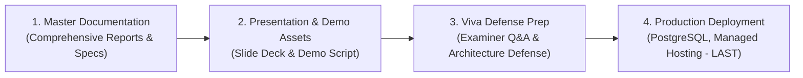

# Final Documentation Plan & Comprehensive Technical Audit

**Project:** Agentic AI Based Intelligent Enterprise Automation and Decision Support System
**Repository:** [https://github.com/Devashree-b-s/agentic-ai-enterprise-automation](https://github.com/Devashree-b-s/agentic-ai-enterprise-automation)
**Active Directory:** `D:\Projects\Agentic AI Integrated Enterprise and Decision Support System`
**Phase:** Documentation Preparation & Strategy (Phase 9A)
**Date:** November 3, 2026
**Auditor:** Antigravity AI Assistant
**Status:** Audit & Strategic Plan Complete (Awaiting User Review)

---

## 1. Executive Summary & Project Sequencing

The project has entered the **Final Documentation Phase**. In accordance with strict project governance, activities are organized in the following sequential order:



> [!IMPORTANT]
> **Production deployment is strictly deferred to the final step.** No deployment, hosting purchases, server reconfiguration, or database resets will take place until documentation, presentation, and viva defense assets are complete and approved.

---

## 2. Audit of Existing Documentation & Gap Analysis

An exhaustive audit of all current documentation in the repository was conducted:

| Existing Document | Current State & Lines | Gap Analysis & Necessary Actions |
| :--- | :--- | :--- |
| **`README.md` (Root)** | Initial 35-line stub from Milestone 1. Contains only basic clone and virtual environment commands. | **Major Gap:** Lacks multi-agent framework details, RAG pipeline explanation, predictive analytics, frontend dashboard overview, role-based login credentials, and comprehensive quickstart instructions. **Action:** Overhaul into a production-grade enterprise repository README. |
| **`docs/ARCHITECTURE.md`** | 91 lines outlining high-level module layers and folder structure. | **Major Gap:** Missing LangGraph supervisor graph diagrams, coordinator concurrency mechanics, tool definitions, vector store chunking architecture, and complete ER database relationships. **Action:** Expand with technical deep dives and ASCII/Mermaid architectural diagrams. |
| **`docs/TEST_PLAN.md`** | 40 lines describing conceptual testing levels from early milestone planning. | **Major Gap:** Lacks documentation of actual executed tests (184/184 passed), E2E browser test findings across 4 roles, test suites breakdown, and coverage metrics. **Action:** Incorporate verified test suite evidence and Playwright browser results. |
| **`frontend/README.md`** | 32 lines of default Vite/Oxlint boilerplate. | **Gap:** Does not document frontend dashboard routing, role-based page permissions, Zustand state store, or Tailwind v4 styling. **Action:** Modernize to describe the enterprise UI. |
| **`docs/github_pre_push_audit.md`** | 309 lines of inspection-only GitHub audit findings. | **Complete:** Serves as a historical audit record. Keep intact without duplication. |
| **`docs/github_pre_push_preparation_report.md`** | 380 lines detailing dependency synchronization and ignore rules. | **Complete:** Serves as an audit record of dependency bounds and dataset privacy checks. Keep intact without duplication. |

---

## 3. Comprehensive 20-Point Documentation Checklist

The upcoming documentation deliverables will comprehensively cover the following 20 core areas:

### 1. Project Overview & Objectives
- Autonomous enterprise decision-support combining deterministic relational data with agentic AI orchestration.
- Integration of Human Resources (HR), Sales Operations, and Inventory Management into a single conversational and analytical interface.
- Safe AI interaction: LLMs are restricted to reasoning and tool invocation, while business math and state mutations are strictly deterministic.

### 2. Problem Statement & Proposed Solution
- **The Problem:** Departmental data silos, slow manual approval bottlenecks, lack of cross-departmental correlation (e.g., matching sales surges to inventory depletion and warehouse staffing), and hallucination risks of generic LLMs.
- **The Solution:** A LangGraph-orchestrated supervisor with 6 specialized domain agents, ChromaDB RAG for internal policy ground-truth, deterministic regression/SMA forecasting, and automated two-phase human-in-the-loop approvals.

### 3. Functional & Non-Functional Requirements
- **Functional Requirements:** User authentication, JWT session lifecycle, role-based dashboard views, cross-department analytics, multi-agent conversational Q&A, knowledge base document upload/chunking/retrieval, purchase order and leave approval pipelines, 3-month predictive sales forecasting, and stock risk detection.
- **Non-Functional Requirements:** Sub-500ms API response times for deterministic routes, sub-second vector similarity retrieval, failure containment in multi-agent background threads, Argon2id cryptographic password security, zero secret leakage, and cross-browser desktop responsiveness.

### 4. Technology Stack
- **Backend:** FastAPI (Python 3.12), Pydantic v2, SQLAlchemy 2.0 ORM, SQLite 3 (WAL mode), Alembic, PyJWT, Argon2-cffi.
- **Agentic AI & RAG:** LangGraph 1.2, LangChain Core 1.7, Groq Cloud API (`qwen/qwen3.8-27b`), Google GenAI (`gemini-1.5-flash`), ChromaDB 1.5, PyPDF 6.21, python-docx 1.2.
- **Frontend:** React 19, TypeScript 5.7, Vite 8.3, Tailwind CSS v4, Zustand 5.0, Axios, Lucide React, Oxlint.
- **Testing & Quality:** Pytest 8.4, HTTPX 0.28, Ruff 0.17, Playwright Browser Automation.

### 5. System Architecture Diagram
- End-to-end multi-tier architectural flow: React SPA -> Axios Interceptors -> FastAPI Route Controllers -> JWT/RBAC Middleware -> Business Services Layer -> SQLAlchemy ORM / SQLite & ChromaDB Vector Store & LangGraph Multi-Agent Engine -> External LLM Providers.

### 6. Multi-Agent Architecture & Coordination
- **Supervisor-Coordinator Pattern:** The `SupervisorAgent` decomposes natural language queries, classifies intent, and delegates tasks to specialized agents.
- **`MultiAgentCoordinator`:** Uses `ThreadPoolExecutor` to execute sub-agent tasks concurrently.
- **Failure Containment:** If a sub-agent worker fails or times out (`AGENT_TIMEOUT_SECONDS=60`), the failure is isolated and formatted into clean error context; the supervisor does not crash.
- **Deterministic Synthesis Fallback:** If LLM inference fails, the system automatically triggers rule-based synthesis from tool results.

### 7. HR, Sales, and Inventory Workflows
- **HR:** Employee lifecycle management, department tracking, leave balance tracking, annual/sick/casual leave applications.
- **Sales:** Customer master, operational order management (`PENDING`, `PROCESSING`, `SHIPPED`, `COMPLETED`, `CANCELLED`), revenue aggregation, and order status updates.
- **Inventory:** Product catalog, real-time stock levels, low-stock threshold detection, stock movements (`PURCHASE_RECEIPT`, `SALES_DISPATCH`, `CORRECTION`), and reorder suggestions.

### 8. Authentication & Role-Based Access Control (RBAC)
- 4 Role Hierarchy:
  1. `Admin`: Unrestricted organizational access, user provisioning, system security audit.
  2. `Manager`: Cross-departmental performance review, purchase and leave approvals, sales forecasts.
  3. `HR`: Employee directory management, leave reviews, headcount analytics.
  4. `Employee`: Personal profile, leave submission, self-service knowledge base search, restricted read-only access.
- Distinction between **Application Role** (permissions in JWT) and **Job Designation** (e.g. employee job title like Executive, Admin, Engineer).

### 9. RAG & Document Intelligence Workflow
- Knowledge base document ingestion: File format check (`.pdf`, `.docx`, `.txt`) and binary magic signature verification (`%PDF-`, `PK\x03\x04`).
- Recursive chunking (500 tokens, 50-token overlap), metadata tagging (department, uploader email, timestamp).
- Embedding persistence in ChromaDB collections.
- Similarity search with metadata-scoped access filtering and source citation synthesis.

### 10. Persistent Conversation Memory
- Database schema: `Conversation` (thread title, user ownership, metadata) and `ConversationMessage` (role, content, tools used, departments used, citations, timestamp).
- Automatic title summarization on initial user prompt.
- Chat history preservation and stateful context injection into supervisor prompts.

### 11. Human-in-the-Loop (HITL) Approval Workflow
- Two-phase commit approval engine.
- High-risk thresholds: Purchase requisitions > $5,000 or initiated by non-executive roles trigger `ApprovalRequest` in `PENDING` status.
- State transitions: `PENDING` -> `APPROVED` / `REJECTED` -> `EXECUTED` / `FAILED`.
- Immutable audit log (`ApprovalAudit`) tracking reviewer ID, decision timestamp, review notes, and before/after state snapshots.

### 12. Predictive Analytics & Model Comparison
- Monthly sales revenue forecasting across a 3-month horizon (`2026-11`, `2026-12`, `2027-01`).
- Evaluation of 4 competing time-series models:
  1. Naive Baseline (persistence)
  2. 3-Month Simple Moving Average (SMA)
  3. Ordinary Least Squares (OLS) Linear Trend
  4. Holt's Linear Exponential Smoothing
- Selection criterion: Lowest Root Mean Squared Error (RMSE) on out-of-sample test window.
- SKU replenishment risk scoring (Critical, Moderate, Low) based on daily velocity, lead times, and current stock.

### 13. Database Schema & Entity-Relationship (ER) Architecture
- Relational entities: `users`, `employees`, `leave_requests`, `customers`, `orders`, `order_items`, `products`, `stock_movements`, `historical_sales`, `approval_requests`, `approval_audits`, `conversations`, `conversation_messages`.
- Cardinality, primary keys, composite unique constraints, and foreign key cascades.

### 14. API Endpoint Documentation
- Complete endpoint inventory covering all 11 FastAPI routers:
  - `/api/auth` (login, register, me, refresh)
  - `/api/employees` & `/api/hr` (employee CRUD, department stats)
  - `/api/leaves` (leave applications, status transitions, metrics)
  - `/api/sales` (customers, orders, revenue reports)
  - `/api/inventory` (products, stock movements, low-stock alerts)
  - `/api/analytics` (cross-departmental metrics, executive KPI overview)
  - `/api/agents` (multi-agent chat, supervisor invocation)
  - `/api/approvals` (approval requests, review, execution, audit trail)
  - `/api/conversations` (chat history, conversation threads, message retrieval)
  - `/api/documents` (upload, list, search, RAG query, delete)
  - `/api/predictions` (sales forecasts, model comparisons, SKU risk scores)

### 15. Frontend Modules & User Roles
- Single-page application architecture built with React 19 and Vite.
- 12 Dedicated Pages: `LoginPage`, `OverviewPage`, `AdminPage`, `HRPage`, `SalesPage`, `InventoryPage`, `PredictionsPage`, `ApprovalsPage`, `DocumentsPage`, `ChatPage`, `UnauthorizedPage`, `NotFoundPage`.
- Role-based route guarding (`ProtectedRoute`) and dynamic sidebar navigation.

### 16. Installation & Local Setup Instructions
- Step-by-step reproduction guide: Git clone, Python `.venv` creation, `pip install -r backend/requirements.txt`, Node.js `npm install`, database initialization, seed data import scripts, and simultaneous server startup.

### 17. Environment Configuration
- Complete reference for `backend/.env.example` with sanitized placeholder strings.
- Explanation of configuration variables: `DATABASE_URL`, `SECRET_KEY`, `ALGORITHM`, `ACCESS_TOKEN_EXPIRE_MINUTES`, `GROQ_API_KEY`, `GEMINI_API_KEY`, `AGENT_TIMEOUT_SECONDS`, `CHROMA_PERSIST_DIRECTORY`.

### 18. Testing & Validation Results
- Full documentation of test coverage:
  - Backend: **184 of 184 tests passed (100% pass rate in 98.49s)**.
  - Frontend: **0 linter errors, production build verified in 2.50s**.
  - Browser Automation: Playwright E2E browser tests passing for Admin, Manager, HR, and Employee personas.

### 19. Limitations & Future Enhancements
- Transparent accounting of deliberate technical trade-offs and future enterprise roadmaps.

### 20. Academic & Technical References
- Academic citations and technical references covering LangGraph multi-agent systems, ReAct prompting, RAG architectures, Argon2id cryptography, and time-series forecasting.

---

## 4. Technical Realities & Accuracy Constraints (Task 3)

To ensure zero divergence between documentation and code, all technical documentation will strictly adhere to the following verified system realities:

1. **Forecasting Window & Evaluation Split:**
   - The historical dataset contains **6 consecutive monthly observations** (`2026-05` to `2026-10`).
   - Time-series model evaluation uses a strict chronological out-of-sample split: the first **4 months** (`2026-05` through `2026-08`) form the Training period, and the last **2 months** (`2026-09` through `2026-10`) are the held-out Test evaluation period.
   - The best model (lowest RMSE) is then refit on the full 6 months to forecast 3 months ahead (`2026-11`, `2026-12`, `2027-01`).
   - Documentation must state that while 6 months is sufficient for trend/moving average comparison, annual seasonality cycles cannot be conclusively proven without 24+ months of data.

2. **Approximate Forecast Uncertainty Bounds:**
   - Confidence bounds for forecasts are approximate standard-error intervals (80% confidence level based on residual variance of the chosen model), rather than Bayesian posterior distributions.

3. **Simulated Purchase Order Execution:**
   - Approving a purchase order updates the internal database state: it generates a `StockMovement` of type `PURCHASE_RECEIPT` and adjusts inventory quantities.
   - **No external EDI, ERP, banking gateway, or supplier payment API** is connected. All purchasing execution is simulated internally.

4. **Document Ingestion & Lack of OCR:**
   - The document ingestion pipeline uses `pypdf` for PDF text extraction and `python-docx` for Word documents.
   - **No OCR engine (e.g., Tesseract) is bundled.** Scanned, image-only PDFs with no embedded text layer will yield zero extracted text and are rejected by validation.

5. **Single-Tenant Architecture:**
   - The application is architected for a **single enterprise organization** operating on a unified relational database with role-based access control.
   - It does **not** feature multi-tenant tenant isolation schemas, tenant IDs in database tables, or organization subscription boundaries.

6. **Historical Sales vs. Operational Orders:**
   - `HistoricalSale` (`data/sales.csv`): Represents historical bulk transactional data (15,851 rows from May 2026 - Oct 2026) utilized for model evaluation, forecasting, and cross-departmental analytics.
   - `Order` & `OrderItem`: Operational operational sales records generated through live API workflows during day-to-day operations.

7. **Role & Data Access Restrictions:**
   - `Employee`: Restricted to personal profile, personal leave applications, and read-only self-service document search. Employees cannot upload company documents or view organizational metrics.
   - `HR`: Full management of employee records and leave approvals; blocked from purchase order approvals and inventory adjustments.
   - `Manager`: Authorized to approve purchase orders and leave requests, view department analytics and forecasts; restricted from creating users.
   - `Admin`: Full access across all departments, user management, and security audit tools.

---

## 5. Proposed Documentation Deliverables & File Structure

To provide complete, non-redundant, and structured documentation, the following **4 core deliverables** are scheduled for creation:

```text
D:\Projects\Agentic AI Integrated Enterprise and Decision Support System\
├── README.md                          # 1. Master Repository Overview & Quickstart Guide
│
└── docs/
    ├── FINAL_DOCUMENTATION_PLAN.md    # [This Audit & Planning Document]
    ├── SYSTEM_DOCUMENTATION.md        # 2. Comprehensive 20-Section Master Technical Report
    ├── API_DOCUMENTATION.md           # 3. Complete REST API Specifications & RBAC Matrix
    └── VIVA_AND_DEMO_GUIDE.md         # 4. Viva Defense Guide & Step-by-Step Role Walkthrough
```

### Detailed Deliverable Descriptions:

#### Deliverable 1: `docs/SYSTEM_DOCUMENTATION.md` (Master Project Report)
- The comprehensive, publication-grade technical report covering all **20 checklist items**.
- Includes complete architecture diagrams, LangGraph state transitions, mathematical formulas for predictive forecasting, ER diagrams, security model, and verified test results.
- Serves as the primary academic and technical documentation for project evaluation.

#### Deliverable 2: `README.md` (Overhauled Root Repository Guide)
- The entry point for developers and evaluators visiting the GitHub repository.
- Features project badges, architecture overview diagram, core features summary, role login credentials table, clear local setup instructions, environment variable guide, and testing commands.

#### Deliverable 3: `docs/API_DOCUMENTATION.md` (API Specification & RBAC Matrix)
- Exhaustive documentation of all 11 API routers and 40+ endpoints.
- Specifies HTTP methods, paths, required headers, request payloads, response schemas, and RBAC authorization matrices (who can call what).

#### Deliverable 4: `docs/VIVA_AND_DEMO_GUIDE.md` (Viva Defense & Live Demonstration)
- Designed specifically for university oral defense and viva examinations.
- Contains 25+ probable examiner questions with structured technical answers.
- Step-by-step role-by-role live demonstration walkthrough (Admin -> Manager -> HR -> Employee).

---

## 6. Codebase Files to Inspect per Documentation Section

| Section / Topic | Core Source Files to Inspect |
| :--- | :--- |
| **Architecture & Multi-Agent** | `backend/app/agents/supervisor.py`, `coordinator.py`, `state.py`, `llm.py`, `specialized/*.py` |
| **Agent Tools & Execution** | `backend/app/agents/tools/*.py`, `backend/app/agents/prompts.py` |
| **Authentication & RBAC** | `backend/app/core/security.py`, `backend/app/api/auth.py`, `backend/app/models/user.py` |
| **RAG & Document Intelligence** | `backend/app/services/chroma_service.py`, `document_parser.py`, `rag_synthesizer.py`, `api/documents.py` |
| **HITL Approvals Engine** | `backend/app/services/approval_service.py`, `models/approval.py`, `api/approvals.py` |
| **Predictive Analytics & Forecasting**| `backend/app/services/prediction_service.py`, `api/predictions.py`, `models/historical_sale.py` |
| **Database & ER Schema** | `backend/app/models/*.py`, `backend/app/db/session.py`, `backend/app/core/bootstrap.py` |
| **HR, Sales & Inventory Services** | `backend/app/services/hr_service.py`, `sales_service.py`, `inventory_service.py`, `analytics_service.py` |
| **Frontend Architecture & State** | `frontend/src/App.tsx`, `store/auth.store.ts`, `components/layout/*.py`, `pages/*.tsx` |
| **Test Evidence & Validation** | `backend/tests/*.py`, `docs/github_pre_push_audit.md`, test execution logs |

---

## 7. Recommended Creation Order

To build documentation systematically and avoid rework, the following order is recommended:

1. **Step 1: Create `docs/SYSTEM_DOCUMENTATION.md`**
   Establish the single source of truth containing the full 20-point technical report.
2. **Step 2: Update `docs/ARCHITECTURE.md` & Create `docs/API_DOCUMENTATION.md`**
   Extract and expand specialized technical references for architectural diagrams and REST API contracts.
3. **Step 3: Update `README.md`**
   Condense the verified technical facts into a high-impact, polished root repository showcase.
4. **Step 4: Create `docs/VIVA_AND_DEMO_GUIDE.md`**
   Synthesize architecture and code into viva preparation Q&A and a live demonstration script for examiners.

---

## 8. Summary of Non-Destructive Status

- No application code or database records have been modified.
- No files have been staged or committed.
- No deployment actions have been initiated.
- All testing suites remain at 100% pass rate.
- Ready for user review and approval to proceed with Step 1.
