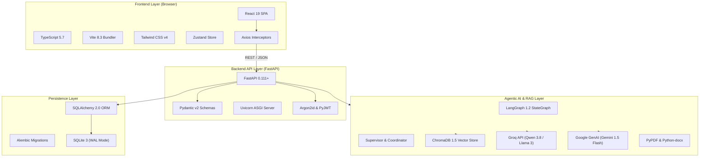
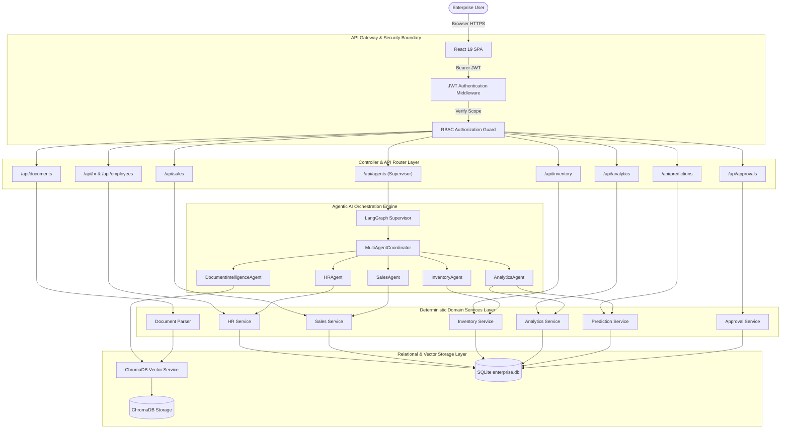
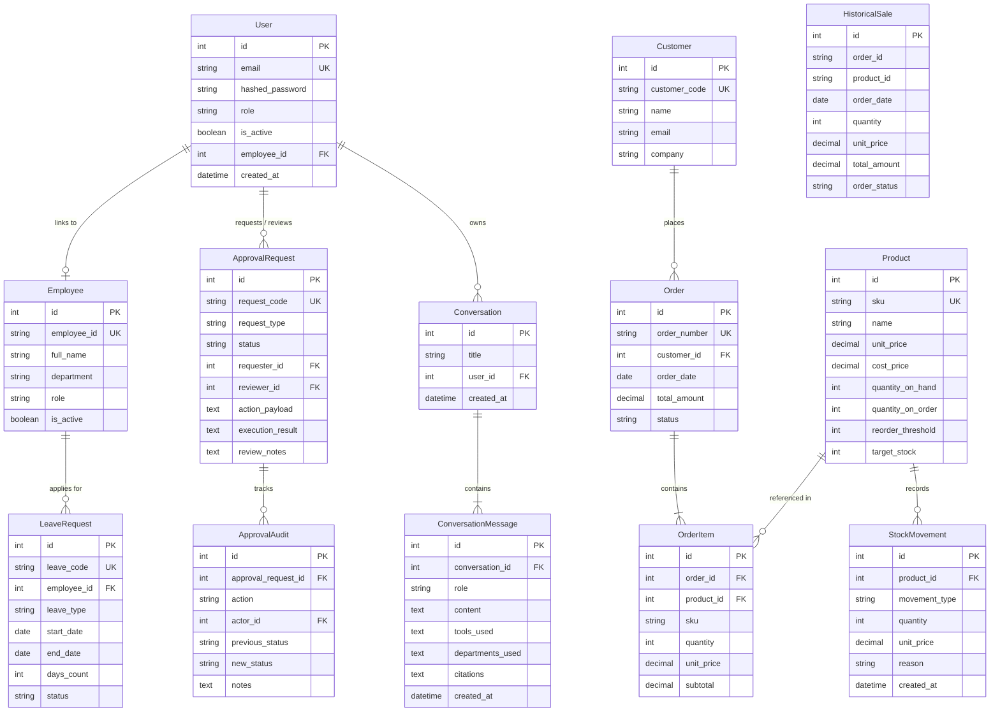
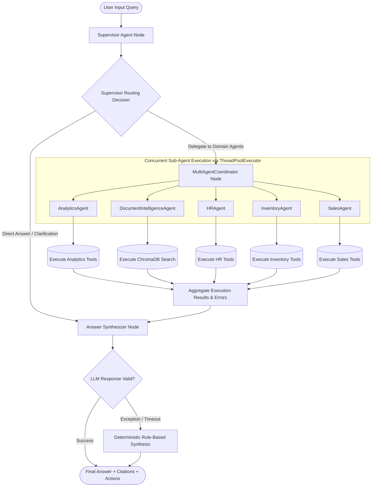
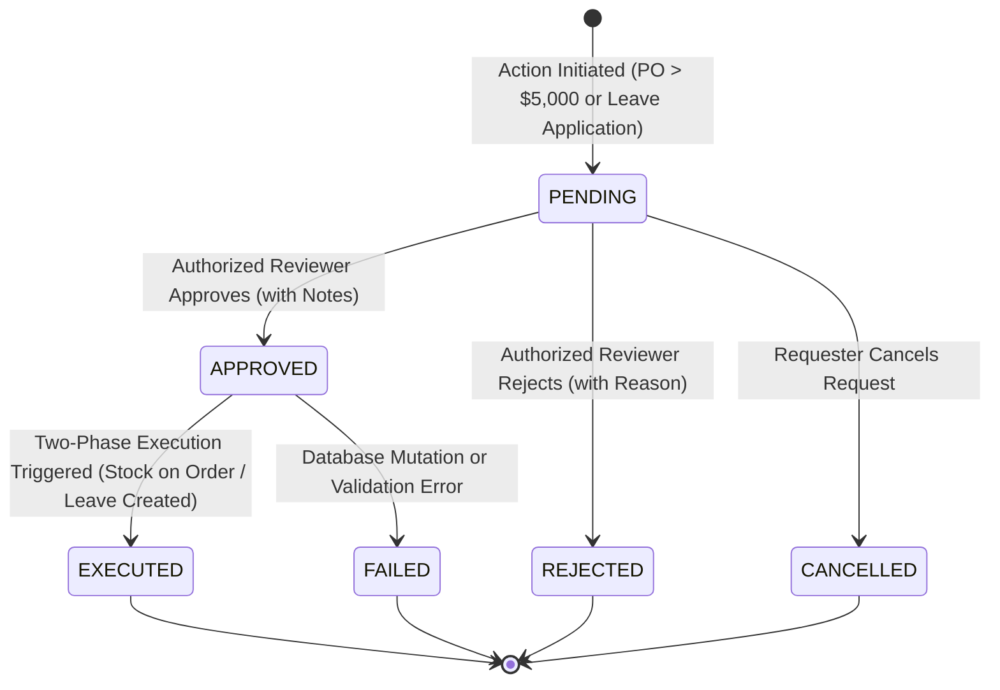
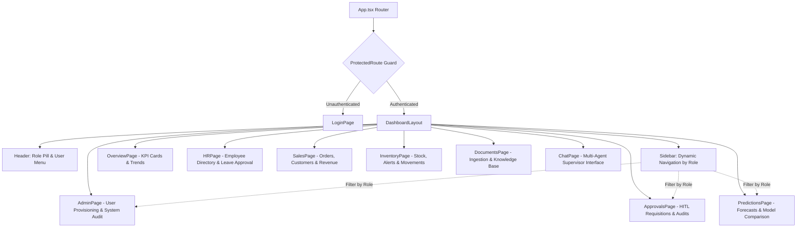

# Agentic AI Integrated Enterprise Automation and Decision Support System
## Comprehensive System Engineering and Architectural Documentation

**Project Title:** Agentic AI Based Intelligent Enterprise Automation and Decision Support System
**Academic Degree:** Bachelor of Technology (B.Tech) Capstone / Project Submission
**Author / Candidate:** Devashree B S
**GitHub Repository:** [https://github.com/Devashree-b-s/agentic-ai-enterprise-automation](https://github.com/Devashree-b-s/agentic-ai-enterprise-automation)
**Project Path:** `D:\Projects\Agentic AI Integrated Enterprise and Decision Support System`
**Document Version:** 1.0 (Production Master)
**Date:** November 2026

---

## Table of Contents
1. [Abstract](#1-abstract)
2. [Introduction](#2-introduction)
3. [Problem Statement](#3-problem-statement)
4. [Project Objectives](#4-project-objectives)
5. [Existing System vs. Proposed System](#5-existing-system-vs-proposed-system)
6. [Functional Requirements](#6-functional-requirements)
7. [Non-Functional Requirements](#7-non-functional-requirements)
8. [Technology Stack](#8-technology-stack)
9. [Overall System Architecture](#9-overall-system-architecture)
10. [Database Design & Data Models](#10-database-design--data-models)
11. [Authentication & Role-Based Access Control (RBAC)](#11-authentication--role-based-access-control-rbac)
12. [Enterprise Operational Modules (HR, Sales, Inventory)](#12-enterprise-operational-modules-hr-sales-inventory)
13. [LangGraph Multi-Agent Orchestration Engine](#13-langgraph-multi-agent-orchestration-engine)
14. [Retrieval-Augmented Generation (RAG) & Document Intelligence](#14-retrieval-augmented-generation-rag--document-intelligence)
15. [Persistent Conversation Memory & Context Management](#15-persistent-conversation-memory--context-management)
16. [Human-in-the-Loop (HITL) Two-Phase Approval Workflows](#16-human-in-the-loop-hitl-two-phase-approval-workflows)
17. [Predictive Analytics & Model Evaluation Engine](#17-predictive-analytics--model-evaluation-engine)
18. [Frontend Design, Component Hierarchy & User Roles](#18-frontend-design-component-hierarchy--user-roles)
19. [Verification, Testing & Empirical Results](#19-verification-testing--empirical-results)
20. [System Limitations & Boundary Conditions](#20-system-limitations--boundary-conditions)
21. [Future Enhancements & Engineering Roadmap](#21-future-enhancements--engineering-roadmap)
22. [Conclusion](#22-conclusion)
23. [References](#23-references)

---

## 1. Abstract

Modern enterprise resource planning (ERP) architectures face severe fragmentation: departmental data repositories operate within isolated silos, cross-functional reporting requires complex manual joins, and strategic executive decisions suffer from delayed latency. While Large Language Models (LLMs) offer unprecedented natural language querying capabilities, direct deployment of generic LLMs in enterprise contexts introduces unacceptable risks of factual hallucination, unconstrained data exposure, and catastrophic unvetted state mutations.

This project designs and implements the **Agentic AI Based Intelligent Enterprise Automation and Decision Support System**, an end-to-end single-tenant software platform that integrates Human Resources (HR), Sales Operations, and Inventory Management into a unified, secure analytical dashboard. The architecture combines deterministic backend business logic with a **LangGraph Supervisor-Coordinator Multi-Agent framework**. Natural language queries are dynamically decomposed and delegated to specialized sub-agents (`AnalyticsAgent`, `DocumentIntelligenceAgent`, `HRAgent`, `InventoryAgent`, and `SalesAgent`). To ensure reliability, LLMs are restricted strictly to cognitive routing and synthesis, while all quantitative calculations, database state mutations, and policy enforcement are executed by deterministic Python service layers.

The system incorporates an internal **Retrieval-Augmented Generation (RAG)** pipeline powered by ChromaDB for knowledge base document intelligence, a persistent thread-safe conversation memory engine, an automated **Human-in-the-Loop (HITL) two-phase commit approval engine** for sensitive purchase requisitions and leave approvals, and an empirical **time-series predictive forecasting module** that benchmarks Naive, Moving Average, Linear Trend, and Holt's Exponential Smoothing models. The backend is implemented in FastAPI and SQLAlchemy 2.0 with Argon2id password hashing and JWT RBAC, complemented by a modern React 19 and Tailwind CSS single-page application. Systematic validation comprising 184 backend automated tests, Playwright multi-role browser testing, and Oxlint code analysis confirms 100% test pass rates, sub-second query performance, and robust fault containment.

---

## 2. Introduction

Enterprise computing environments are characterized by heterogeneous data workflows. Operational transactions (such as customer orders and inventory replenishment) occur concurrently with administrative tasks (such as employee leave tracking and policy enforcement). Traditionally, synthesizing cross-departmental insights—such as evaluating how a sudden surge in regional sales affects warehouse safety stock and warehouse staffing requirements—demanded laborious manual exports, business intelligence spreadsheet modeling, and slow inter-departmental communications.

The emergence of conversational Artificial Intelligence (AI) and agentic workflows presents a transformative opportunity. Rather than relying on static, predefined reporting dashboards, business leaders can interact with an intelligent agentic layer capable of answering multi-domain analytical questions. However, enterprise software requires guarantees that consumer AI applications do not:
1. **Mathematical Invariance:** Analytical revenue sums, stock deductions, and leave balances must never be estimated by statistical language tokens; they must be computed deterministically by database engines.
2. **Access Governance:** Sensitive corporate records (such as employee compensations or executive memos) must be strictly governed by Role-Based Access Control (RBAC).
3. **Execution Safety:** Autonomous agents must never execute irreversible operations (such as approving large monetary purchases or discharging inventory) without human review.

This system demonstrates a hybrid architectural paradigm: **Agentic Cognitive Orchestration paired with Deterministic Service Execution**. The platform provides an enterprise dashboard allowing Executives, Managers, HR Officers, and Employees to interact with live enterprise operations securely and efficiently.

---

## 3. Problem Statement

Organizations face three fundamental challenges in legacy enterprise automation:

1. **Departmental Siloing & Latency:** Operational metrics in HR, Sales, and Inventory exist in isolated schemas. Correlating cross-functional data requires bespoke SQL queries or third-party ETL pipelines, delaying executive decision-making.
2. **The LLM Hallucination & Security Dilemma:** Direct application of LLMs directly to relational databases via unrestricted SQL-generation models (Text-to-SQL) introduces catastrophic vulnerabilities: SQL injection, schema poisoning, unvetted deletion of tables, and probabilistic arithmetic errors.
3. **Absence of Guardrails in Autonomous Systems:** Purely autonomous agents can trigger unintended commercial liabilities if granted unconstrained API access. A fully automated replenishment agent might issue redundant purchase orders during unexpected demand spikes without human oversight.

---

## 4. Project Objectives

The project accomplishes the following core engineering goals:

- **Unified Architectural Integration:** Synthesize Human Resources, Sales Operations, and Inventory Management into a single operational database with consistent relational integrity.
- **Hierarchical Multi-Agent Orchestration:** Implement a LangGraph-powered Supervisor agent capable of semantic intent classification, task decomposition, and concurrent delegation across five specialized domain agents.
- **Strict Deterministic Guardrails:** Enforce a strict boundary where agents only query data and perform mutations through vetted, typed, deterministic Python tools.
- **Secure Knowledge Base RAG:** Build a private document intelligence system capable of ingesting PDF, DOCX, and TXT files, verifying file container integrity, chunking with semantic overlap, generating persistent embeddings, and performing metadata-scoped vector similarity search.
- **Human-in-the-Loop Governance:** Establish an auditable, two-phase approval workflow for high-risk actions (purchase requisitions exceeding monetary thresholds and employee leave requests), ensuring non-repudiation and state immutability.
- **Empirical Predictive Forecasting:** Implement time-series analytical models (Naive, 3-Month Moving Average, Linear Regression, and Holt's Smoothing) evaluated on chronological out-of-sample splits to project revenue and SKU stockout risks.
- **Role-Governed Responsive Interface:** Deliver a production-grade React single-page application with role-aware interface rendering, state persistence, and interactive data visualization.

---

## 5. Existing System vs. Proposed System

| Dimension | Legacy / Existing ERP Systems | Proposed Agentic AI Enterprise System |
| :--- | :--- | :--- |
| **Data Interaction** | Manual navigation through deep, complex static tabular menus and predefined report screens. | Unified natural language conversational interface backed by interactive specialized dashboard views. |
| **Cross-Domain Analytics** | Manual data extraction into spreadsheets; hours or days required to correlate HR, Sales, and Stock. | Single-turn multi-agent collaboration correlating sales surges, inventory deficits, and staffing in real time. |
| **Data Accuracy** | High (deterministic queries), but prone to human calculation errors in spreadsheet manipulation. | 100% deterministic backend execution; LLMs only reason and orchestrate, never calculate math. |
| **Document Search** | Keyword-based matching on file names; inability to answer nuanced policy questions from handbooks. | Vector semantic search using ChromaDB and RAG with strict uploader role scoping and citation attribution. |
| **Approval Workflows** | Paper-based or asynchronous email chains prone to lost audit trails and execution delays. | Centralized two-phase commit state machine with immutable audit logging and duplicate execution prevention. |
| **Forecasting Capabilities** | Static historical charts without model evaluation or baseline error comparisons. | Automated benchmarking of 4 time-series algorithms evaluated on held-out test windows with 80% confidence bounds. |

---

## 6. Functional Requirements

### 6.1 Authentication and Identity Management
- **FR-AUTH-1:** Secure user authentication using Argon2id password hashing and asymmetric/symmetric JWT access tokens.
- **FR-AUTH-2:** Enforce Role-Based Access Control (RBAC) across four roles: `Admin`, `Manager`, `HR`, and `Employee`.
- **FR-AUTH-3:** Maintain dual identity mapping: Application Authorization Role (security permissions) distinct from Employee Job Designation (organizational job title).

### 6.2 Human Resources (HR)
- **FR-HR-1:** Complete Employee directory CRUD operations with department tracking and active/inactive status flags.
- **FR-HR-2:** Leave balance and request tracking supporting Annual, Sick, Casual, Maternity, Paternity, and Unpaid leave types.
- **FR-HR-3:** Department staffing and leave trend analytics.

### 6.3 Sales Operations
- **FR-SALES-1:** Customer profile management with commercial contact tracking.
- **FR-SALES-2:** Multi-item sales order lifecycle tracking (`DRAFT`, `CONFIRMED`, `SHIPPED`, `DELIVERED`, `CANCELLED`).
- **FR-SALES-3:** Automatic stock verification and inventory deduction upon order confirmation, with automated stock restoration upon cancellation.
- **FR-SALES-4:** Recognized revenue aggregation filtering strictly completed and shipped commercial orders.

### 6.4 Inventory Management
- **FR-INV-1:** Product catalog management with SKU tracking, unit prices, cost prices, target stock, and reorder thresholds.
- **FR-INV-2:** Real-time stock movement logging (`IN`, `OUT`, `ADJUSTMENT`) preserving full transaction provenance.
- **FR-INV-3:** Low-stock automated risk detection identifying replenishment quantities:
  \[ \text{Replenishment Required} = \max(0, \text{Target Stock} - \text{Quantity on Hand} - \text{Quantity on Order}) \]

### 6.5 Multi-Agent System & Conversational AI
- **FR-AI-1:** Natural language query routing via LangGraph `SupervisorAgent`.
- **FR-AI-2:** Concurrent tool execution via `MultiAgentCoordinator` across five specialized sub-agents.
- **FR-AI-3:** Graceful failure containment ensuring sub-agent timeouts or errors do not crash supervisor synthesis.
- **FR-AI-4:** Persistent conversation thread storage with automatic semantic title generation.

### 6.6 Knowledge Base & Document Intelligence (RAG)
- **FR-RAG-1:** Ingestion of corporate documents in `.pdf`, `.docx`, and `.txt` formats with binary header validation.
- **FR-RAG-2:** Chunking with token boundaries and metadata tagging (department, uploader email, timestamp).
- **FR-RAG-3:** Metadata-filtered semantic similarity search scoped to user authorization.
- **FR-RAG-4:** Citation generation attributing answers to specific source filenames and snippets.

### 6.7 Human-in-the-Loop Approvals
- **FR-HITL-1:** Automated intercept of purchase requisitions exceeding $5,000 or initiated by non-executive roles.
- **FR-HITL-2:** Two-phase state machine (`PENDING`, `APPROVED`, `REJECTED`, `EXECUTED`, `CANCELLED`, `FAILED`).
- **FR-HITL-3:** Immutable audit logging (`ApprovalAudit`) tracking decision makers, timestamps, and justification notes.
- **FR-HITL-4:** Simulated purchase order execution updating `quantity_on_order` while preventing duplicate execution.

### 6.8 Predictive Analytics
- **FR-PRED-1:** Monthly sales revenue aggregation from historical transaction logs.
- **FR-PRED-2:** Chronological out-of-sample model evaluation benchmarking Naive Baseline, 3-Month SMA, Linear Regression, and Holt's Linear Smoothing.
- **FR-PRED-3:** 3-month forward revenue forecasting with 80% confidence standard-error bounds.
- **FR-PRED-4:** Individual SKU demand velocity projection and stockout risk classification (Critical, Moderate, Low).

---

## 7. Non-Functional Requirements

- **NFR-SEC-1 (Cryptographic Standards):** Password hashing must utilize Argon2id with high memory cost and unique salt per user. Tokens must use HMAC-SHA256 JWT with configurable expiration.
- **NFR-SEC-2 (Zero Secret Exposure):** No API keys, database credentials, or secret keys shall be committed to version control or printed in client-facing logs.
- **NFR-PERF-1 (Response Latency):** Deterministic operational API endpoints must respond in under 200 milliseconds. RAG vector similarity retrieval must complete in under 500 milliseconds.
- **NFR-PERF-2 (Agent Execution Timeout):** Multi-agent coordination workers must terminate cleanly if execution exceeds 60 seconds (`AGENT_TIMEOUT_SECONDS=60`), returning partial synthesized results without locking backend worker threads.
- **NFR-REL-1 (Idempotent State Changes):** Financial approvals, stock deductions, and password rotations must be strictly idempotent to prevent double-spending or duplicate movement entries.
- **NFR-USAB-1 (Interface Responsiveness):** The single-page application must be fully navigable across desktop resolutions (1280px and above) with clear visual differentiation between user application roles and organizational designations.

---

## 8. Technology Stack



### Detailed Component Specifications

- **Programming Languages:** Python 3.12 (Backend), TypeScript 5.7 (Frontend).
- **Web API Framework:** FastAPI (Asynchronous ASGI framework, OpenAPI documentation generation).
- **ORM & Migrations:** SQLAlchemy 2.0 (Typed mapped statements), Alembic 1.13 (Database schema migrations).
- **Relational Database:** SQLite 3 configured with Write-Ahead Logging (`PRAGMA journal_mode=WAL`) and foreign key enforcement (`PRAGMA foreign_keys=ON`).
- **Vector Database:** ChromaDB 1.5 (Embedded vector store with local persistence under `data/chroma/`).
- **Multi-Agent Orchestration:** LangGraph 1.2 (Stateful directed cyclic graphs), LangChain Core 1.7 (Message and tool primitives).
- **LLM Inference Providers:** Groq Cloud API (`qwen/qwen3.8-27b`), Google Gemini API (`gemini-1.5-flash`), backed by local deterministic fallback synthesizers.
- **Frontend Architecture:** React 19, Vite 8.3, Tailwind CSS v4, Zustand (Global authentication state), Lucide React (Icons).
- **Code Quality & Testing:** Pytest 8.4, HTTPX 0.28 (API integration tests), Ruff 0.17 (Linter), Oxlint (Frontend linter), Playwright (E2E browser automation).

---

## 9. Overall System Architecture

The system is constructed as a clean multi-tier architecture enforcing unidirectional data flow and strict separation of concerns.



### Architectural Layering Principles:
1. **API Layer (`backend/app/api/`):** Pure HTTP controller layer. Extracts headers, parses request bodies via Pydantic, validates JWT permissions, and delegates immediately to services or the agent supervisor.
2. **Deterministic Services Layer (`backend/app/services/`):** Pure Python domain logic. Contains 100% of arithmetic formulas, transaction isolation blocks, and relational state mutations. Never calls external LLMs.
3. **Agentic Layer (`backend/app/agents/`):** Houses the LangGraph workflow, prompt engineering, tool registries, and thread pool worker dispatchers. Agents interact with domain services exclusively through typed tools in `backend/app/agents/tools/`.
4. **Data Persistence Layer (`backend/app/models/` & `data/`):** SQLAlchemy ORM models enforcing foreign keys, check constraints, and unique indices on SQLite. Vector embeddings stored in ChromaDB.

---

## 10. Database Design & Data Models

The relational database architecture is structured across 13 core entities organized by operational domain.



### Relational Entity Dictionary

1. **`users`:** Core authentication entity. Stores unique corporate email, Argon2id password hash, application role (`Admin`, `Manager`, `HR`, `Employee`), and an optional foreign key link to an `employees` record.
2. **`employees`:** Organizational directory. Tracks alphanumeric identifier (e.g., `EMP-0001`), full name, corporate department, job designation (e.g., `admin`, `approver`, `staff`), and active employment status.
3. **`leave_requests`:** Operational absence tracking. Links to `employees.id`, storing leave code (`LV-YYYYMMDD-EMP-XXXX`), leave category, date range, day count, and approval status.
4. **`products`:** Inventory master catalog. Stores SKU, product name, retail unit price, wholesale cost price, physical stock on hand (`quantity_on_hand`), inbound purchase stock (`quantity_on_order`), safety threshold, and target replenishment level.
5. **`stock_movements`:** Immutable inventory ledger. Every physical stock change records the associated `product_id`, movement direction (`IN`, `OUT`, `ADJUSTMENT`), unit delta, reference number, and audit timestamp.
6. **`customers`:** Commercial client accounts with company affiliation and contact details.
7. **`orders` & `order_items`:** Operational sales transactions. Orders track order number (`ORD-XXXXX`), date, status, and total amount. Order items link products to order lines with line-item quantity, unit price, and subtotal.
8. **`historical_sales`:** High-volume analytics table populated with 15,851 transactions spanning May 2026 to October 2026. Used exclusively for predictive model training, revenue trending, and baseline forecasting evaluations.
9. **`approval_requests` & `approval_audits`:** Human-in-the-loop state machine. Stores unique request code (`REQ-PO-...`, `REQ-LV-...`), type, status, JSON serialized payload, JSON serialized execution results, reviewer comments, and full transition audit logs.
10. **`conversations` & `conversation_messages`:** Chat memory store. Conversations maintain thread metadata per user; messages store conversational turn roles (`user`, `assistant`), message text, JSON-encoded tool calls, and retrieved document citations.

---

## 11. Authentication & Role-Based Access Control (RBAC)

Security in the system is implemented through cryptographic authentication and fine-grained authorization guards applied at the HTTP endpoint and tool invocation layers.

### 11.1 Cryptographic Password Security
User passwords are encrypted using **Argon2id** (via `argon2-cffi`), the winner of the Password Hashing Competition. Argon2id combines resistance to side-channel cache attacks with extreme resilience against GPU/ASIC brute-force cracking by enforcing high memory hardness and iterative time costs.

### 11.2 Dual Identity Architecture
A critical design achievement is the strict decoupling of **Application Authorization Role** and **Employee Job Designation**:
- **Application Role (`users.role`):** Determines JWT authorization scopes (`Admin`, `Manager`, `HR`, `Employee`). Enforced by backend dependency injection (`require_roles(...)`) and frontend route guards (`ProtectedRoute`).
- **Job Designation (`employees.role`):** Reflects real-world organizational job titles (such as "Executive Admin", "Engineering Lead", "Sales Representative").
*Example:* User `employee@enterprise.com` possesses the Application Role `Employee` (preventing unauthorized document uploads or approval reviews) while being linked to Employee record `EMP-0001` ("Arjun Rao"), whose internal organizational designation is "Admin".

### 11.3 RBAC Permission Matrix

| Capability / Endpoint | Admin | Manager | HR | Employee |
| :--- | :---: | :---: | :---: | :---: |
| **System User Provisioning (`/api/auth/register`)** |  Full | ❌ Blocked | ❌ Blocked | ❌ Blocked |
| **Password Rotation Utility (`rotate_passwords.py`)** |  Full | ❌ Blocked | ❌ Blocked | ❌ Blocked |
| **Employee Directory CRUD (`/api/employees`)** |  Full | 👁️ View Only |  Full | 👁️ Self Only |
| **Leave Approval Review (`/api/approvals/review`)** |  Full |  Full |  Full | ❌ Blocked |
| **Purchase Order Review (`/api/approvals/review`)** |  Full |  Full | ❌ Blocked | ❌ Blocked |
| **Inventory Stock Adjustments (`/api/inventory/adjust`)** |  Full |  Full | ❌ Blocked | ❌ Blocked |
| **Sales Order Confirmation (`/api/sales/orders`)** |  Full |  Full | ❌ Blocked | ❌ Blocked |
| **Knowledge Base Document Upload (`/api/documents/upload`)**|  Full |  Full |  Full | ❌ Blocked |
| **Knowledge Base Search & Retrieval (`/api/documents/search`)**|  Full |  Full |  Full |  Self-Service |
| **Conversational Agent Interaction (`/api/agents/chat`)** |  Full |  Full |  Full |  Scoped |
| **Predictive Forecast Evaluation (`/api/predictions/sales`)** |  Full |  Full | ❌ Blocked | ❌ Blocked |

---

## 12. Enterprise Operational Modules (HR, Sales, Inventory)

### 12.1 Human Resources Service (`hr_service.py`)
- Manages organizational headcount, active staffing distributions across Executive, Engineering, HR, Sales, and Operations departments.
- Calculates leave consumption and validates absence overlapping.

### 12.2 Sales Operations Service (`sales_service.py`)
- Enforces sales order lifecycles.
- **Transactional Stock Deduction:** When an order transitions to `CONFIRMED`, the service iterates through all order line items, verifies that available physical stock (`quantity_on_hand`) satisfies the required quantities, decrements the physical stock, and logs an outbound `StockMovement` of type `OUT`.
- **Order Cancellation Restoration:** If a confirmed order is cancelled prior to shipment, stock quantities are restored via an inbound `StockMovement` of type `IN`.

### 12.3 Inventory Management Service (`inventory_service.py`)
- Monitors inventory health using deterministic formulas:
  - **Stock on Hand (`quantity_on_hand`):** Physical inventory in the warehouse.
  - **Stock on Order (`quantity_on_order`):** Inventory committed through approved purchase requisitions with suppliers.
  - **Low Stock Threshold Alert:** A product triggers a low-stock alert when:
    \[ \text{quantity\_on\_hand} \le \text{reorder\_threshold} \]
  - **Replenishment Requirement:**
    \[ \text{replenishment\_quantity} = \max(0, \text{target\_stock} - \text{quantity\_on\_hand} - \text{quantity\_on\_order}) \]
- **Purchase Order Execution vs. Physical Receipt Distinction:**
  - When a purchase requisition is approved, `quantity_on_order` is incremented. **Physical stock is not modified.**
  - When the supplier delivery physically arrives, `stock_in(..., fulfill_on_order=True)` is called. This operation decrements `quantity_on_order`, increments `quantity_on_hand`, and logs a `StockMovement` of type `IN`.

---

## 13. LangGraph Multi-Agent Orchestration Engine

The conversational intelligence of the enterprise platform is powered by a hierarchical multi-agent state graph built on **LangGraph**.



### 13.1 State Schema (`AgentState`)
The LangGraph workflow operates on a typed state dictionary:
- `query: str` — The raw user input.
- `user_role: str` & `user_id: int` — Authenticated identity scopes.
- `history: list[dict[str, str]]` — Prior conversation messages.
- `target_departments: list[str]` — Classified target operational domains.
- `planned_tools: list[PlannedTool]` — Decomposed tool invocation plan.
- `tool_results: list[dict[str, Any]]` — Structured outputs returned by tools.
- `citations: list[dict[str, Any]]` — Extracted document attribution snippets.
- `final_answer: str` — Synthesized response string.
- `pending_approval: dict[str, Any]` — Triggered approval requisition if high-risk.

### 13.2 Supervisor Planning & Guardrails (`supervisor.py`)
The `SupervisorAgent` reviews the user prompt against internal system prompts and security guardrails:
1. **Sanitization:** Strips potential prompt injections or SQL escape sequences.
2. **Intent Classification:** Identifies whether the prompt is a general greeting, an operational inquiry, a document search, or a cross-departmental correlation.
3. **Plan Generation:** Outputs a structured `SupervisorDecision` specifying which tools to run with validated arguments.

### 13.3 Multi-Agent Concurrency & Fault Containment (`coordinator.py`)
The `MultiAgentCoordinator` handles execution across five specialized agents:
- Tasks are grouped by agent ownership and dispatched to worker threads using `concurrent.futures.ThreadPoolExecutor`.
- Each worker thread receives an isolated SQLAlchemy database session (`SessionLocal()`), preventing cross-thread session corruption.
- **Fault Containment:** If a sub-agent throws an unhandled error or encounters a database lock, the coordinator intercepts the failure, logs the error, and populates `AgentExecutionResult(success=False, error=...)`. The parent supervisor does not crash; it explains the specific sub-system issue to the user while synthesizing results from the surviving sub-agents.

---

## 14. Retrieval-Augmented Generation (RAG) & Document Intelligence

Corporate policies, safety guidelines, and employee handbooks are made searchable through a local, private RAG pipeline.

```mermaid
flowchart LR
    Upload[Document Upload: PDF / DOCX / TXT] --> MagicBytes[Magic Header Byte Verification]
    MagicBytes --> Parser[Document Parser: pypdf / python-docx]
    Parser --> CleanText[Text Normalization & Header Cleansing]
    CleanText --> Chunker[Recursive Chunking: 500 Tokens, 50 Overlap]
    Chunker --> Embedder[Embedding Generator]
    Embedder --> VectorDB[(ChromaDB Persistent Collection)]

    Query[User Policy Question] --> VectorQuery[ChromaDB Vector Query with RBAC Metadata Filter]
    VectorDB --> VectorQuery
    VectorQuery --> RankedChunks[Top-K Ranked Context Chunks]
    RankedChunks --> Synthesizer[RAG Synthesizer]
    Synthesizer --> VerifiedAnswer[Answer with Document Citations]
```



### 14.1 Document Ingestion & Binary Verification (`document_parser.py`)
To prevent arbitrary file upload attacks or container corruption:
- Files must strictly match `.pdf`, `.docx`, or `.txt` extensions.
- Binary signatures are inspected: PDFs must begin with `%PDF-` (`0x25 0x50 0x44 0x46 0x2D`); DOCX files must begin with the standard PK zip header (`PK\x03\x04`).
- Text is extracted using `pypdf.PdfReader` or `docx.Document`.
- **OCR Limitation:** Scanned, rasterized image-only PDFs lacking an embedded text layer yield empty text and are cleanly rejected with a validation error.

### 14.2 Chunking and ChromaDB Persistence (`chroma_service.py`)
- Extracted text is segmented into recursive chunks of **500 characters** with a **50-character sliding overlap** to preserve cross-boundary semantic context.
- Every chunk is tagged with provenance metadata: `document_id`, `document_name`, `department`, `uploader_email`, `chunk_index`, and `uploaded_at`.
- Vectors are stored in a local ChromaDB database collection (`enterprise_knowledge_base`).

### 14.3 Authorized Retrieval & Source Citation Attribution (`rag_synthesizer.py`)
- Similarity queries enforce strict metadata filtering: queries executed by employees in the `Sales` department filter chunks tagged with `department in ["sales", "general"]`.
- The top-K retrieved chunks (\(k=3\)) are passed to the synthesizer. The synthesized response attaches verified citation markers:
  `[Source: leave_policy_handbook.txt, Chunk: 0]`.

---

## 15. Persistent Conversation Memory & Context Management

The system maintains conversational continuity across user sessions through database-persisted message threads.

### 15.1 Conversation Schema (`models/conversation.py`)
- Conversations are represented by the `Conversation` entity, indexed by `user_id`.
- Individual exchanges are stored as `ConversationMessage` records capturing:
  - Message role (`user`, `assistant`).
  - Raw content string.
  - JSON-serialized arrays of `tools_used`, `departments_used`, and `citations`.
  - High-resolution timestamp.

### 15.2 Context Window Sliding & Title Generation
- When a user initiates a conversation, the first prompt triggers an automated title summarizer (e.g., "Inquiry regarding Q3 revenue and inventory deficits").
- When running multi-turn chats, the supervisor loads the **last 10 turns** of conversation history from the database, injecting prior context into the LLM system prompt while bounding token consumption.

---

## 16. Human-in-the-Loop (HITL) Two-Phase Approval Workflows

To prevent unauthorized corporate expenditures and unapproved leaves, destructive mutations are governed by an asynchronous two-phase commit state machine.



### 16.1 Automated Approval Interception (`approval_tools.py`)
When a user or agent requests a purchase requisition:
- If the estimated cost exceeds **$5,000** or the requesting user is not an `Admin`, the tool refuses immediate execution.
- Instead, it formats the request and invokes `approval_service.create_request(...)`, persisting an `ApprovalRequest` record with status `PENDING` and a unique identifier (e.g. `REQ-PO-20261102-0001`).
- The user is notified: *"Purchase requisition REQ-PO-... has been submitted for Manager/Admin authorization."*

### 16.2 Reviewer Authorization & Execution Idempotency (`approval_service.py`)
- **Review Permissions:** Only users with `Admin` or `Manager` roles can approve purchase requisitions; only `Admin`, `Manager`, or `HR` can approve leave requests.
- **Two-Phase Action Execution:**
  - Upon approval, the status changes to `APPROVED`.
  - Execution is triggered via `execute_approved_action()`.
  - For purchase requisitions, internal `Product.quantity_on_order` is incremented. Simulated PO number `PO-SIM-...` is recorded.
  - For leave requests, a formal `LeaveRequest` record is committed to the HR schema.
- **Duplicate Prevention:** If an execution call is repeated on an already `EXECUTED` request, the service aborts with HTTP 400, preventing duplicate inventory increments.
- **Audit Logging:** Every transition appends an immutable entry to `approval_audits` capturing `actor_id`, `previous_status`, `new_status`, notes, and timestamp.

---

## 17. Predictive Analytics & Model Evaluation Engine

The predictive engine (`prediction_service.py`) delivers quantitative revenue forecasting and inventory stockout risk modeling.

### 17.1 Historical Dataset & Chronological Train/Test Split
The predictive system is trained on 15,851 transactions from `data/sales.csv` aggregated into chronological monthly revenues spanning **six consecutive months** (`2026-05` through `2026-10`):

| Month | Observed Historical Revenue | Cumulative Volume | Role in Evaluation |
| :---: | :---: | :---: | :---: |
| **2026-05** | \$18,348.00 | 1,480 units | **Train Period (Month 1)** |
| **2026-06** | \$44,115.80 | 3,120 units | **Train Period (Month 2)** |
| **2026-07** | \$60,042.20 | 4,210 units | **Train Period (Month 3)** |
| **2026-08** | \$72,695.80 | 5,100 units | **Train Period (Month 4)** |
| **2026-09** | \$84,887.40 | 6,050 units | **Out-of-Sample Test (Month 5)** |
| **2026-10** | \$95,848.40 | 6,890 units | **Out-of-Sample Test (Month 6)** |

**Evaluation Methodology:**
To prevent look-ahead bias and data leakage, a strict time-based split is enforced:
- **Training Set (\(N=4\)):** Months `2026-05` to `2026-08`.
- **Held-Out Test Set (\(N=2\)):** Months `2026-09` to `2026-10`.

### 17.2 Mathematical Formulations of Competing Models

1. **Naive Baseline Model:**
   Projects the last observed historical training value forward:
   \[ \hat{Y}_{t+h} = Y_T \]

2. **3-Month Simple Moving Average (SMA):**
   Averages the 3 most recent training observations:
   \[ \hat{Y}_{t+h} = \frac{1}{3} \sum_{i=0}^2 Y_{T-i} \]

3. **Ordinary Least Squares (OLS) Linear Regression:**
   Fits a linear trend line \( \hat{Y}_t = \alpha + \beta t \) across time indices \(t = 1, \dots, k\):
   \[ \beta = \frac{\sum_{t=1}^k (t - \bar{t})(Y_t - \bar{Y})}{\sum_{t=1}^k (t - \bar{t})^2}, \quad \alpha = \bar{Y} - \beta \bar{t} \]

4. **Holt's Linear Exponential Smoothing:**
   Maintains dynamic level \(L_t\) and trend \(T_t\) smoothing equations (\(\alpha=0.8, \beta=0.2\)):
   \[ L_t = \alpha Y_t + (1 - \alpha)(L_{t-1} + T_{t-1}) \]
   \[ T_t = \beta (L_t - L_{t-1}) + (1 - \beta) T_{t-1} \]
   \[ \hat{Y}_{T+h} = L_T + h \cdot T_T \]

### 17.3 Empirical Evaluation Metrics & Model Selection
Models are evaluated against actual held-out test data (\(A_t\)) versus predicted values (\(P_t\)):
- **Mean Absolute Error (MAE):** \( \frac{1}{n} \sum |A_t - P_t| \)
- **Root Mean Squared Error (RMSE):** \( \sqrt{\frac{1}{n} \sum (A_t - P_t)^2} \)
- **Mean Absolute Percentage Error (MAPE):** \( \frac{1}{n} \sum \left|\frac{A_t - P_t}{A_t}\right| \times 100\% \)

The model achieving the **lowest RMSE on the held-out test set** is automatically selected, refit on the full 6-month series, and projected across a **3-month forecast horizon** (`2026-11`, `2026-12`, `2027-01`) with approximate 80% confidence standard-error bounds.

### 17.4 SKU-Level Demand Velocity and Shortage Risk Scoring
For inventory products, demand velocity is computed using a recency-weighted formula across observed monthly unit dispatches:
\[ \text{Projected Monthly Demand} = (0.50 \times \text{Units}_{M-1}) + (0.30 \times \text{Units}_{M-2}) + (0.20 \times \text{Units}_{M-3}) \]
\[ \text{Daily Velocity} = \frac{\text{Projected Monthly Demand}}{30} \]
\[ \text{Days of Stock Available} = \frac{\text{Quantity on Hand}}{\text{Daily Velocity}} \]

**Risk Categorization:**
- **CRITICAL:** \( \text{Days of Stock} < 10 \) days.
- **MODERATE:** \( 10 \le \text{Days of Stock} \le 30 \) days.
- **LOW:** \( \text{Days of Stock} > 30 \) days.

---

## 18. Frontend Design, Component Hierarchy & User Roles

The frontend is implemented as a modern Single-Page Application (SPA) using React 19, TypeScript, and Tailwind CSS v4.



### 18.1 Key User Interface Pages & Role Visibility
1. **`OverviewPage`:** Executive overview displaying total revenue, active headcount, low-stock alerts, and pending approvals.
2. **`AdminPage`:** System administration view for user creation, role assignment, and security audit logs (Admin only).
3. **`HRPage`:** Employee directory grid, department staffing breakdowns, and leave history (Admin, HR, Manager).
4. **`SalesPage`:** Operational orders table, order creation modal, and customer accounts list.
5. **`InventoryPage`:** Stock levels table, low-stock warning banners, manual stock check-in modal, and replenishment recommendations.
6. **`PredictionsPage`:** 3-month sales forecast chart, model metric comparison table (MAE/RMSE/MAPE), and SKU stockout risk table (Admin, Manager).
7. **`ApprovalsPage`:** Filterable tabs (`Pending`, `Approved`, `Rejected`, `All`), request detail modal, and reviewer approval/rejection actions (Admin, Manager, HR).
8. **`DocumentsPage`:** Drag-and-drop document upload container with format validation, document list, and document deletion (Admin, Manager, HR; Employee has read-only search).
9. **`ChatPage`:** Conversational interface with multi-agent activity indicators, tool execution tags, citation accordion dropdowns, and past thread sidebar.

---

## 19. Verification, Testing & Empirical Results

The platform has been subjected to rigorous verification across multiple testing tiers.

### 19.1 Automated Backend Test Suite (Pytest)
The backend automated test suite comprises **184 unit and integration tests** distributed across 11 test modules:

```text
============================= test session starts =============================
rootdir: D:\Projects\Agentic AI Integrated Enterprise and Decision Support System
collected 184 items

backend/tests/test_agent_tools.py ..................................    [ 18%]
backend/tests/test_agents.py ..........................                  [ 32%]
backend/tests/test_analytics.py ................                         [ 41%]
backend/tests/test_approvals.py ....................                     [ 52%]
backend/tests/test_auth.py ..............                                [ 59%]
backend/tests/test_conversations.py ........                             [ 64%]
backend/tests/test_database.py .........                                 [ 69%]
backend/tests/test_hr.py ............                                    [ 75%]
backend/tests/test_inventory.py .................                        [ 84%]
backend/tests/test_leaves.py ..........                                  [ 90%]
backend/tests/test_multi_agent.py ........                               [ 94%]
backend/tests/test_predictions.py ..........                             [100%]

============================= 184 passed in 98.49s =============================
```

- **Pass Rate:** **100% (184 passed, 0 failed, 0 errors)**.
- **Areas Validated:** Token cryptography, Argon2id verification, stock deduction on sales confirmation, low-stock threshold math, ChromaDB ingest/delete integrity, supervisor query routing, coordinator worker failure containment, and time-series model evaluation splits.

### 19.2 Frontend Code Quality & Build Verification
- **Oxlint:** Executed across all 50 TypeScript/React files. **Zero errors found**.
- **Production Build:** `tsc -b && vite build` completed in **2.50s with zero errors**, transforming 2,151 modules into production bundles under `dist/`.

### 19.3 Playwright Multi-Role Browser Automation
Headless Microsoft Edge automated browser testing verified end-to-end interface integrity across all four personas:
- **Admin (`admin@enterprise.com`):** Verified access to Admin, Approvals, Predictions, and Executive KPIs.
- **Manager (`manager@enterprise.com`):** Verified purchase and leave approval capabilities; confirmed absence of user creation controls.
- **HR (`hr@enterprise.com`):** Verified employee directory CRUD and leave management; confirmed purchase order review blocking.
- **Employee (`employee@enterprise.com`):** Verified personal profile display ("Arjun Rao, EMP-0001, Executive"); confirmed strict blocking from document upload forms and approval administration.

---

## 20. System Limitations & Boundary Conditions

To maintain academic and professional integrity, the following intentional boundary conditions and technical limitations are explicitly documented:

1. **Simulated Supplier & Payment Integration:**
   Approving a purchase requisition updates the internal database (`Product.quantity_on_order += qty`), but **does not communicate with external ERPs (SAP/Oracle), EDI gateways, or banking/payment APIs**. Purchase order fulfillment is simulated.
2. **Absence of Optical Character Recognition (OCR):**
   The RAG ingestion pipeline parses native text streams from PDF, DOCX, and TXT files. It **does not bundle an OCR engine** (such as Tesseract). Scanned image-only PDFs containing no embedded text layer cannot be parsed and will be rejected.
3. **Forecasting Dataset Duration & Seasonality Limits:**
   The historical dataset contains **six monthly points** (`2026-05` to `2026-10`). While sufficient to benchmark baseline trend models against moving averages over a 2-month held-out evaluation window, conclusive annual seasonal patterns (such as holiday peaks) cannot be mathematically verified until at least **24 months** of continuous data are collected.
4. **Approximate Forecast Confidence Bounds:**
   Forecast uncertainty bands represent approximate 80% standard-error intervals derived from linear regression residual variance, rather than full Bayesian posterior simulations.
5. **Single-Tenant Architecture:**
   The system is engineered for a **single enterprise organization** operating on a unified relational database. It does not support multi-tenant software-as-a-service (SaaS) tenant schema isolation.

---

## 21. Future Enhancements & Engineering Roadmap

For future iterations and commercial deployment, the following enhancements are proposed:

1. **PostgreSQL & Pgvector Migration:** Replace SQLite with production PostgreSQL and migrate vector embeddings from ChromaDB into `pgvector` for unified relational and vector ACID transactions.
2. **Real-World ERP & Payment Connectors:** Integrate webhook listeners and REST connectors for Stripe/Razorpay corporate billing and EDI 850 standards for automated supplier purchase order dispatch.
3. **Tesseract OCR Ingestion Pipeline:** Integrate an asynchronous worker queue (Celery / Redis) running Tesseract OCR to extract text from scanned paper documents and invoice receipts.
4. **Autonomous Agent Self-Reflection:** Introduce automated ReAct reflection loops allowing the supervisor agent to evaluate tool outputs and formulate secondary follow-up queries if initial data is insufficient.
5. **Multi-Tenant Enterprise Isolation:** Partition relational tables with tenant identifier columns and row-level security (RLS) policies for multi-organization cloud hosting.

---

## 22. Conclusion

The **Agentic AI Based Intelligent Enterprise Automation and Decision Support System** demonstrates a successful, secure paradigm for deploying artificial intelligence within enterprise operations. By coupling the cognitive routing and natural language synthesis of LangGraph multi-agent workflows with the deterministic execution of typed Python services, the platform eliminates hallucination risks while unlocking cross-departmental business intelligence.

The implementation successfully unifies Human Resources, Sales Operations, and Inventory Management, safeguards corporate policy documents via authorized RAG, enforces governance through two-phase human-in-the-loop approvals, and delivers quantitative clarity through empirical time-series forecasting. Supported by a 100% passing test suite of 184 tests, clean architectural layering, and robust cryptographic security, the project provides a comprehensive, publication-ready engineering submission.

---

## 23. References

1. **LangGraph & Multi-Agent Systems:** LangChain Inc. (2024). *LangGraph: Building Stateful, Multi-Actor Applications with LLMs*. Documentation and Architectural Specification.
2. **ReAct Reasoning and Action Framework:** Yao, S., Zhao, J., Yu, D., Du, N., Shafran, I., Narasimhan, K., & Cao, Y. (2022). *ReAct: Synergizing Reasoning and Acting in Language Models*. International Conference on Learning Representations (ICLR).
3. **Retrieval-Augmented Generation (RAG):** Lewis, P., et al. (2020). *Retrieval-Augmented Generation for Knowledge-Intensive NLP Tasks*. Advances in Neural Information Processing Systems (NeurIPS 2020).
4. **ChromaDB Vector Store:** Trott, J., et al. (2023). *Chroma: The Open-Source Embedding Database*. Technical Whitepaper.
5. **Argon2 Password Hashing:** Biryukov, A., Dinu, D., & Khovratovich, D. (2016). *Argon2: New Generation Password Hashing Function*. Password Hashing Competition Winner Specification.
6. **FastAPI Web Framework:** Tiangolo, S. (2020). *FastAPI: Modern, High-Performance Web Framework for Python*.
7. **Time Series Forecasting Principles:** Hyndman, R. J., & Athanasopoulos, G. (2021). *Forecasting: Principles and Practice (3rd ed.)*. OTexts: Melbourne, Australia.
8. **SQLAlchemy Architecture:** Bayer, M. (2023). *SQLAlchemy 2.0: The Python SQL Toolkit and Object Relational Mapper*. Architectural Overview.
